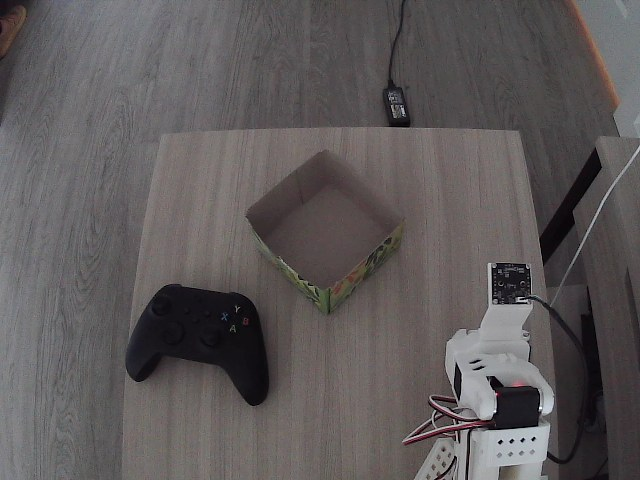
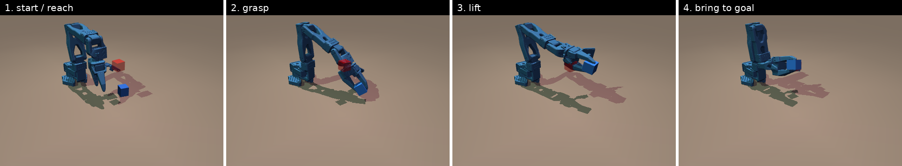
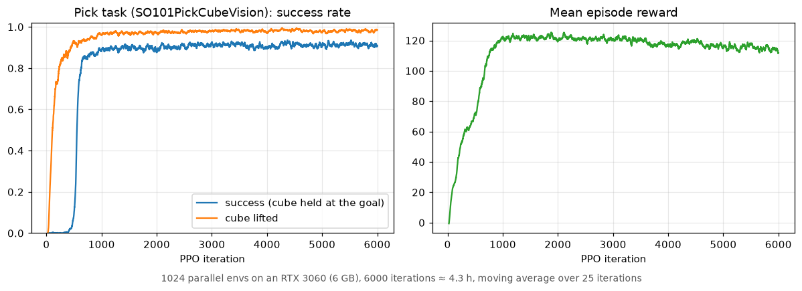
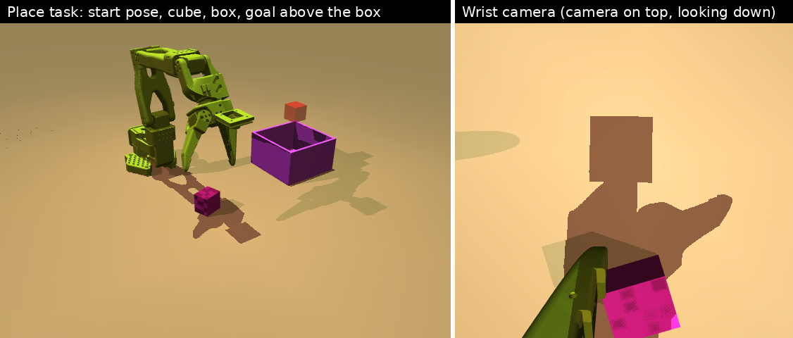
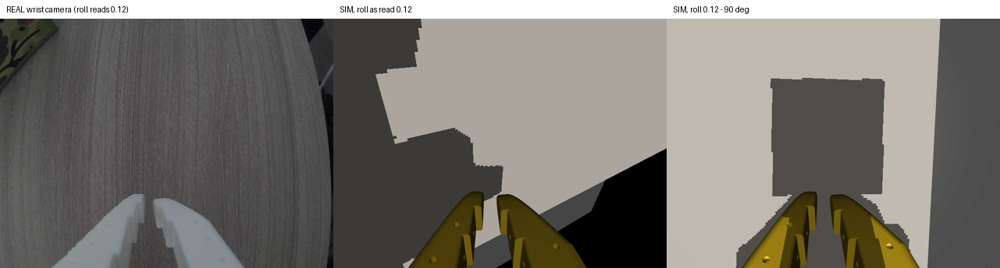

# Squint_RL_so101

用强化学习训练 **SO-101 机械臂**（只有从动臂，没有主动臂）根据**腕部相机**画面抓取方块。
仿真和训练用 [MuJoCo Playground](https://github.com/google-deepmind/mujoco_playground)：MuJoCo Warp 负责 GPU 物理和渲染，RSL-RL 负责 PPO。
训好的策略直接部署到真机。



*真机布置（顶部相机拍摄）：右下角是 SO-101，腕部相机装在夹爪上，桌上是 12×12×7 cm 的盒子。*

## 任务

### 1. 抓方块并送到目标点：`SO101PickCubeVision`（已训完）



- 方块随机出现在底座前方 20–35 cm、左右 ±10 cm 的范围，大小和颜色每局都变。红色半透明方块是目标点。
- 训练：1024 个并行环境，6000 轮，约 4.3 小时（RTX 3060 6 GB）。
- 训练指标：成功率约 91%，抬起率约 98%。



### 2. 抓方块放进盒子：`SO101PlaceCubeVision`（训练中）



代码在 [`place_task.py`](mujoco_playground/mujoco_playground/tasks/manipulation/pick_cube/so101/place_task.py)。

- **夹法**：起始时手腕比抓方块任务多转 −90°。腕部相机在夹爪**上方**笔直朝下看，两指**左右**合拢。
- **盒子**：12×12×7 cm，壁厚 5 mm。名义位置在底座转盘中心前方 16 cm、往机械臂左边 23 cm。每局随机偏移 ±2.5 cm、旋转 ±10°，颜色也随机。
- **盒子位置怎么告诉策略**：目标点固定在盒子正上方 12 cm，作为数字输入给策略。腕部相机只需要看到方块。
- **奖励（逐级）**：
  1. 靠近方块
  2. 夹住
  3. 抬起
  4. 送到盒子上方（粗 8 cm 尺度 + 精细 2 cm 尺度）
  5. 在盒口上方松开
  6. 方块在盒中（每步最大的一项）
  7. 松手后抬离盒子

  方块一进盒子，1–4 项就关闭，避免学成"一直夹着不放"。
- **姿势和安全**：
  - 夹爪朝下（≥45°）、两指水平。
  - 碰盒子、碰桌子扣分，关节接近极限扣分。
  - 动作要平滑。

## 技术框架

| | |
|---|---|
| 仿真 / 渲染 | MuJoCo 4 + MuJoCo Warp（GPU 上批量仿真和相机渲染） |
| 算法 | RSL-RL PPO，非对称 actor-critic |
| Actor（部署用） | 腕部相机 64×64 渲染 → 中心裁剪、缩到 16×16 → 2 层 CNN；加上关节角/速度、末端位姿、目标点、上一步动作 → MLP |
| Critic（只在训练时用） | 仿真里的特权信息：方块、目标点、盒子的真实位置等 |
| 控制 | 10 Hz，增量关节角动作 |
| 域随机化 | 相机位置 ±5 mm / 朝向 ±4° / 视场角 ±10%，颜色，光照，方块大小，摩擦，舵机增益，标定偏差 |

## 机器分工

- **VMware Ubuntu 虚拟机**：所有代码和数据都在这里。部署、标定、TensorBoard 也在这里跑（CPU）。机械臂和两个 USB 相机直通到虚拟机。
- **Windows 笔记本的 WSL2（RTX 3060 6 GB）**：只负责训练。[`wsl-gpu`](wsl-gpu) 通过 SSH 进入 WSL2，用 sshfs 挂载虚拟机里的这个目录，在 WSL2 的 venv 里运行。代码不会复制到 WSL2。

## 目录结构

```
train_so101.sh            一站式脚本：训练 / 状态 / TensorBoard / 标定 / 悬停测试 / 部署
wsl-gpu                   在 WSL2 的 GPU 上运行命令（SSH + sshfs）
docs/images/              README 图片
mujoco_menagerie/robotstudio_so101/   SO-101 的 MJCF 模型和网格（含腕部相机）
mujoco_playground/        精简后的 MuJoCo Playground（只保留 SO101 相关部分）
  mujoco_playground/tasks/manipulation/pick_cube/
    task.py, mdp.py, reset.py          通用的抓方块任务、奖励、重置
    so101/task.py                      SO101 抓方块（视觉版）
    so101/place_task.py                SO101 放盒子（本项目新增）
    so101/deploy/                      仿真回放 / 真机部署
  mujoco_playground/robots/so101/      仿真常量、真机驱动、标定工具
  third_party/reaf_sim/                REAF 仿真框架
  .local/                              这台机械臂的标定、串口、相机路径（本机配置）
runs/                     训练输出（不在 git 里）
```

## 常用命令

```bash
./train_so101.sh start place          # 训练放盒子任务（约 2.6 小时）
./train_so101.sh status               # 当前训练进度
./train_so101.sh board                # TensorBoard，端口 6006
./train_so101.sh stop                 # 停止训练（检查点保留）
./train_so101.sh resume [run] [iters] # 从最新检查点继续
./train_so101.sh deploy sim           # 仿真回放，浏览器打开 http://<虚拟机 IP>:8080
./train_so101.sh hover 10 place       # 真机：移到起始姿势停 10 秒（不跑策略）
./train_so101.sh deploy real          # 真机部署（任务和目标点按 run 自动选）
./train_so101.sh calibrate            # 重新标定从动臂
```

环境：

- 虚拟机部署环境：`~/.venvs/playground-deploy`，用 `uv sync --frozen --extra so101 --extra rl --group cpu` 安装。
- WSL2 训练环境：`~/.venvs/playground-gpu`。
- 一定要加 `--frozen`，否则 uv 会改写 `uv.lock`。

## 真机注意事项

- **标定时的中间姿势**：
  - 前臂水平、手腕伸直、两指上下排列，**腕部相机朝左**，参考图 [middle_pose.png](mujoco_playground/mujoco_playground/robots/so101/real/assets/middle_pose.png)。
  - 如果标定时相机朝上，手腕旋转会差 90°，真机画面就和仿真不一致。2026-11-22 发现并修正过一次，下图是修正时的对比。旧标定备份在 `.local/` 里。

  

- **腕部相机**：InnoMaker 1080p，使用 640×480 模式。两个相机的序列号相同，所以要按 `/dev/v4l/by-path` 区分。
- **部署前**：关掉相机预览窗口，盒子用胶带固定在约定位置，手放在电源开关旁。

## 来源与许可

- `mujoco_playground/`：来自 [google-deepmind/mujoco_playground](https://github.com/google-deepmind/mujoco_playground)（提交 `0ce4c2b`），Apache-2.0。精简到只保留 SO101，本项目的修改处都标了 `Squint_RL_so101`。
- `mujoco_playground/third_party/reaf_sim/`：REAF 仿真框架，Apache-2.0。
- `mujoco_menagerie/robotstudio_so101/`：来自 [google-deepmind/mujoco_menagerie](https://github.com/google-deepmind/mujoco_menagerie)（提交 `370c439`），Apache-2.0。
